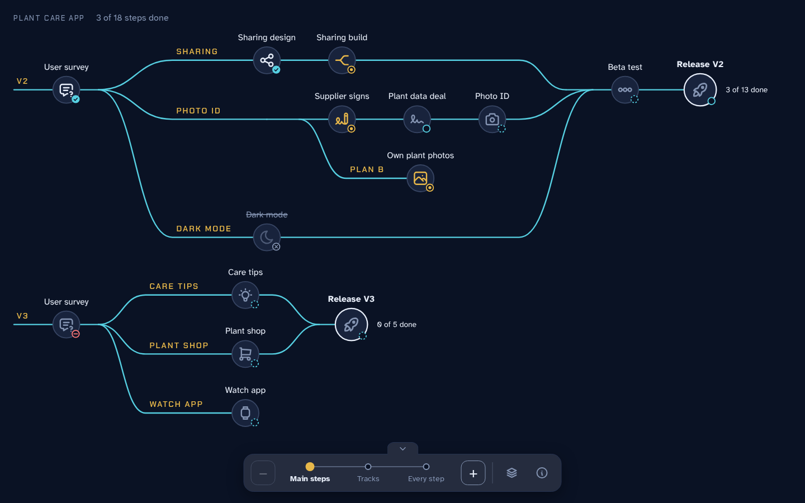

# Roadmapper

This doc covers what Roadmapper is, how to install and start it, and where the other docs are.

Roadmapper draws a roadmap as a tree, which the docs call the plan. The roadmap is kept in one JSON file, the roadmap file. At the level 'Main steps', anyone can read the plan, even a child in 3rd grade. The next levels, 'Tracks' and 'Every step', show more detail.

<picture>
  <source media="(prefers-color-scheme: light)" srcset="https://raw.githubusercontent.com/true-byte/roadmapper/master/docs/images/roadmap-light.png">
  
</picture>

## Install

Run this command in your project's folder. [docs/01-intro.md](docs/01-intro.md#what-it-needs) gives the Node version that Roadmapper needs, and each step in detail.

```sh
npm install roadmapper
```

## Quick start

Run these commands in your project's folder. The first command copies the sample roadmap file, 'Plant care app', to `roadmap.json`. The second command serves the app, which shows `roadmap.json`.

```sh
cp node_modules/roadmapper/roadmap/sample.roadmap.json roadmap.json
npx roadmapper
```

Open the address that `npx roadmapper` prints. The page redraws the plan each time you save `roadmap.json`.

With no `roadmap.json` in the folder, `npx roadmapper` shows `roadmap/roadmap.json`. To show a file anywhere else, name it:

```sh
npx roadmapper plans/plant-care.json
```

To show the roadmap in a React app, use the component `Roadmap`:

```jsx
import { Roadmap } from 'roadmapper/react';
import roadmap from './roadmap.json';

<Roadmap roadmap={roadmap} style={{ height: 720 }} />
```

[docs/05-embed.md](docs/05-embed.md) gives each prop of `Roadmap`, and the tag `<roadmapper-view>` for a page without React.

## Claude Code skill

The `roadmapper` skill tells Claude how to write and keep a roadmap file. With it, Claude writes the plan as a row of main steps in priority order. To install the skill, run this command in your project's folder:

```sh
npx skills add https://github.com/true-byte/roadmapper --skill roadmapper -a claude-code --copy
```

[docs/06-skill.md](docs/06-skill.md) says what to ask Claude, and how to update the skill.

## Docs

[docs/01-intro.md](docs/01-intro.md) says what Roadmapper is for, and lists each doc.

The docs are a [nerDDocs](https://github.com/true-byte/nerDDocs) site. Each page holds its text at three reading levels: 'Basics', 'Details' and 'Internals'. To read a page at one reading level, with a slider that switches between them, run this command in your project's folder:

```sh
npx nerddocs node_modules/roadmapper/docs
```

On GitHub, a page shows the text of all its reading levels, with each fence line, such as `::: details internals`, as text.

## Contributing

[CONTRIBUTING.md](https://github.com/true-byte/roadmapper/blob/master/CONTRIBUTING.md) says how to set up a clone, run the tests, add a theme, send a change and make a release. It also gives the rules for code and docs, and what each folder of the clone holds.

## License

Roadmapper is under the MIT License. [LICENSE](LICENSE) holds its text.

The fonts that Roadmapper draws in, Atkinson Hyperlegible and Chakra Petch, are under the SIL Open Font License 1.1. Their license texts ship with the font files, in `src/themes/default/fonts/` and in the folder `fonts/` of each build and export.
